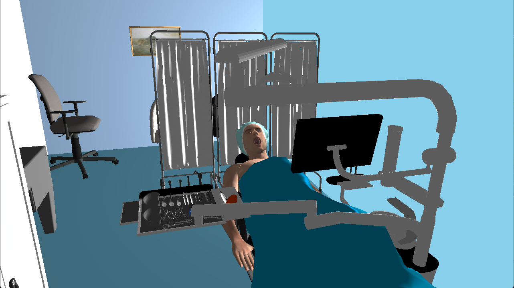

# 🦷 Dental Implant Simulator

<div align="center">


**Simulador 3D interactivo para visualización y manipulación de implantes dentales**



[Instalación](#-instalación) • [Uso](#-uso) • [Controles](#-controles) • [Arquitectura](#-arquitectura) • [Contribuir](#-contribuir)

</div>

---

## 📖 Descripción

Aplicación de escritorio desarrollada en **C++17** con **OpenGL 4.6** para la visualización tridimensional de procedimientos de implantes dentales. Permite interactuar con modelos 3D de instrumental quirúrgico, implantes y el entorno de un consultorio dental.

### ✨ Características principales

- 🎯 **Cámara orbital 3D** - Navegación fluida con múltiples vistas médicas predefinidas
- 🦴 **Animación esquelética** - Soporte para modelos con armature (hasta 200 huesos)
- 🔧 **Animación por keyframes** - Objetos interactivos con transiciones suaves
- 🖱️ **Drag & Drop** - Selección y manipulación de instrumental
- 🎨 **Renderizado PBR** - Materiales con propiedades físicas (metallic, roughness)
- 💉 **Modelos detallados** - Consultorio, instrumental, implantes, cabezales

---

## 🚀 Instalación

### Requisitos previos

| Requisito | Versión mínima |
|-----------|---------------|
| **Windows** | 10/11 |
| **Visual Studio** | 2022 (v143) |
| **CMake** | 3.15+ |
| **GPU** | Compatible con OpenGL 4.6 |

### Dependencias incluidas

El proyecto incluye todas las dependencias en la carpeta `external/`:

- **GLFW 3** - Gestión de ventanas y entrada
- **GLAD** - Cargador de funciones OpenGL
- **GLM** - Matemáticas para gráficos
- **Assimp** - Importación de modelos 3D (GLB/GLTF/FBX)
- **stb_image** - Carga de texturas

### Compilación

```powershell
# Clonar el repositorio
git clone https://github.com/tu-usuario/dental-implant-simulator.git
cd dental-implant-simulator

# Configurar con CMake (genera solución de Visual Studio)
cmake -S . -B build -G "Visual Studio 17 2022" -A x64

# Compilar
cmake --build build --config Release

# Ejecutar
.\build\Release\Cuadrupedo_IIIU.exe
```

#### Compilación con VS Code

Si usas VS Code, ejecuta las tareas predefinidas:
1. `Ctrl+Shift+B` → Selecciona **Build Project**
2. `F5` para ejecutar con el debugger

---

## 🎮 Uso

### Inicio rápido

Al ejecutar la aplicación, se carga automáticamente la escena del consultorio dental con todos los modelos. La cámara se posiciona sobre el paciente.

### 🎛️ Controles

#### Navegación de cámara

| Control | Acción |
|---------|--------|
| `Click derecho + Arrastrar` | Rotar cámara (orbital) |
| `Click medio + Arrastrar` | Pan (desplazar vista) |
| `Scroll` | Zoom in/out |
| `W/A/S/D` | Mover objetivo de cámara |
| `Q/E` | Subir/Bajar cámara |
| `Shift + WASD` | Movimiento rápido (3x) |
| `R` | Resetear cámara |

#### Vistas médicas predefinidas (Teclado numérico)

| Tecla | Vista |
|-------|-------|
| `Numpad 1` | Frontal |
| `Numpad 2` | Lateral derecha |
| `Numpad 3` | Lateral izquierda |
| `Numpad 4` | Superior (oclusal) |
| `Numpad 5` | Inferior |
| `Numpad 6` | Oclusal directa |
| `Numpad 7` | Panorámica |

#### Interacción con objetos

| Control | Acción |
|---------|--------|
| `Click izquierdo` | Seleccionar / Arrastrar objeto |
| `Doble click` | Resetear posición del objeto |
| `Shift + Click derecho` | Regresar a posición inicial (keyframe) |

#### Transformaciones (con objeto seleccionado)

| Control | Acción |
|---------|--------|
| `1` | Modo trasladar |
| `2` | Modo rotar |
| `X/Y/Z` | Restringir a eje |
| `Flechas` | Aplicar transformación |
| `ESC` | Deseleccionar |

---

## 🏗️ Arquitectura

```
📦 dental-implant-simulator/
├── 📁 src/                      # Código fuente
│   ├── main.cpp                 # Punto de entrada
│   ├── Application.h            # Clase principal (ciclo de vida)
│   ├── Camera.h                 # Sistema de cámara orbital
│   ├── Model.h                  # Cargador de modelos ASSIMP
│   ├── Mesh.h                   # Representación de mallas
│   ├── Shader.h                 # Gestión de shaders GLSL
│   ├── Animation.h              # Animación esquelética
│   ├── Animator.h               # Controlador de animaciones
│   ├── Bone.h                   # Representación de huesos
│   ├── NodeAnimation.h          # Animación por keyframes
│   └── InteractionSystem.h/cpp  # Ray casting y selección
│
├── 📁 shaders/                  # Shaders GLSL
│   ├── skeletal_animation.*     # Para modelos con huesos
│   ├── static.*                 # Para modelos estáticos
│   ├── axis.*                   # Ejes de coordenadas
│   └── hud.*                    # Interfaz de usuario
│
├── 📁 assets/models/            # Modelos 3D (GLB)
├── 📁 external/                 # Dependencias de terceros
├── 📁 docs/                     # Documentación adicional
├── CMakeLists.txt               # Configuración de CMake
└── README.md                    # Este archivo
```

### Flujo de ejecución

```
main() → Application::initialize() → Application::run()
                                           │
                    ┌──────────────────────┴──────────────────────┐
                    │                 GAME LOOP                    │
                    │  processInput() → update() → render()        │
                    └─────────────────────────────────────────────┘
```

### Sistema de renderizado

| Shader | Uso |
|--------|-----|
| `skeletal_animation` | Modelos con esqueleto (deformación en GPU) |
| `static` | Modelos sin animación de huesos |
| `axis` | Visualización de ejes XYZ |
| `hud` | Overlay de interfaz |

---

## 📊 Tecnologías

| Categoría | Tecnología |
|-----------|------------|
| **Lenguaje** | C++17 |
| **Gráficos** | OpenGL 4.6 Core Profile |
| **Ventanas** | GLFW 3 |
| **Matemáticas** | GLM |
| **Modelos 3D** | Assimp (GLTF/GLB) |
| **Build** | CMake 3.15+ |
| **IDE** | Visual Studio 2022 / VS Code |

---

## 🤝 Contribuir

¡Las contribuciones son bienvenidas! Por favor:

1. Fork el repositorio
2. Crea una rama para tu feature (`git checkout -b feature/nueva-funcionalidad`)
3. Commit tus cambios (`git commit -am 'Agregar nueva funcionalidad'`)
4. Push a la rama (`git push origin feature/nueva-funcionalidad`)
5. Abre un Pull Request

### Guía de estilo

- Usar nombres en `camelCase` para variables/funciones
- Usar nombres en `PascalCase` para clases
- Prefijo `m_` para miembros privados
- Documentar funciones públicas con Doxygen

---

## 📄 Licencia

Este proyecto está licenciado bajo la **Licencia MIT** - ver el archivo [LICENSE](LICENSE) para más detalles.

---

## 👤 Autor

Desarrollado como proyecto académico/profesional.

---

## 🙏 Agradecimientos

- [LearnOpenGL](https://learnopengl.com/) - Tutoriales de OpenGL
- [Assimp](https://github.com/assimp/assimp) - Importación de modelos
- [GLFW](https://www.glfw.org/) - Gestión de ventanas
- Modelos 3D creados en Blender

